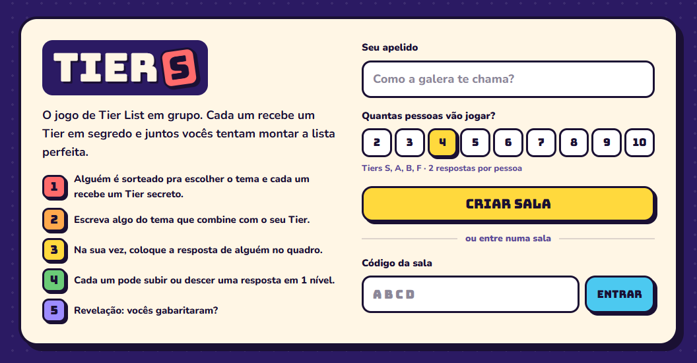

<div align="center">


# TierS

**O jogo de Tier List em grupo.** Cada jogador recebe um Tier secreto (S, A, B, C ou F), escreve algo do tema sorteado que combine com ele, e o grupo tenta montar a Tier List perfeita. De 2 a 10 jogadores, cada um no seu celular.

[](https://tiers-jogo.netlify.app)




</div>

## Como jogar

1. **Crie uma sala** com o seu apelido e escolha quantas pessoas vão jogar. Compartilhe o código de 4 letras.
2. **Cada um entra pelo celular** com o código e um apelido. A partida começa quando a sala está completa.
3. **Um jogador sorteado escolhe o tema** entre duas opções (ou sorteia de novo, até 3 vezes por partida).
4. **Cada um recebe um Tier secreto** e escreve algo do tema que combine com ele. Quem tirou F escreve algo F mesmo.
5. **Na sua vez, coloque a resposta de alguém no quadro.** Você nunca mexe na própria resposta.
6. **Ajustes:** cada um pode subir ou descer uma resposta em 1 nível (ou passar).
7. **Revelação:** acerto vale +1, erro vale −1. Se o time gabaritar, todo mundo ganha +2.

Sem cadastro, sem app pra instalar: abre no navegador do celular e pronto.

## Como rodar

### 1. Criar o projeto no Supabase

1. Crie um projeto em [supabase.com](https://supabase.com).
2. Em **Authentication > Sign In / Providers**, ative **Allow anonymous sign-ins**. Os jogadores entram só com um apelido, sem cadastro.
3. Em **SQL Editor**, rode os arquivos de `supabase/migrations/` em ordem: primeiro `20261103000000_tiers.sql`, depois `20261103010000_theme_choice.sql`, `20261103020000_reroll_recharge.sql` `20261103030000_player_counts.sql`, `20261103040000_no_own_swap.sql` e por último `20261103050000_more_themes.sql`.
   Ou rode o arquivo único `supabase/setup_completo.sql`, que equivale aos 6. Ou ainda, com a Supabase CLI: `supabase link` e `supabase db push`.
4. Em **Database > Publications**, confira se a tabela `rooms` aparece em `supabase_realtime`. A migration já faz isso.

### 2. Configurar o front

```bash
cp .env.example .env.local
```

Preencha `.env.local` com a URL do projeto e a chave anon (ou publishable), que ficam em **Project Settings > API**.

### 3. Rodar

```bash
npm install
npm run dev
```

O `npm run dev` já sobe com `--host`, então dá para abrir no celular pelo IP do PC na mesma rede Wi‑Fi (o Vite mostra o endereço no terminal).

### 4. Publicar

O repositório já traz um `netlify.toml` (build `npm run build`, pasta `dist`). Na Netlify, conecte o repositório ou envie a pasta `dist`, e cadastre as mesmas duas variáveis (`VITE_SUPABASE_URL` e `VITE_SUPABASE_ANON_KEY`) em **Project configuration > Environment variables**. Vercel e Cloudflare Pages funcionam do mesmo jeito.

[](https://app.netlify.com/start/deploy?repository=https://github.com/matheuspeixotoo/TierS)

A versão oficial está no ar em **[tiers-jogo.netlify.app](https://tiers-jogo.netlify.app)**.

## Formações

O host escolhe quantas pessoas vão jogar ao criar a sala (dá pra mudar na sala de espera). A partida só começa com a sala completa, e a formação depende desse número:

| Jogadores | Tiers no quadro | Respostas por Tier | Respostas por jogador |
|---|---|---|---|
| 2 | S A B C F | 2 | 5, uma de cada Tier |
| 3 | S B F | 3 | 3 |
| 4 | S A B F | 2 | 2 |
| 5 | S A B C F | 2 | 2 |
| 6 | S B F | 4 | 2 |
| 7 | S A B F | 2 | 1 (um jogador escreve 2, revezando a cada rodada) |
| 8 | S A B F | 2 | 1 |
| 9 | S A B C F | 2 | 1 (um jogador escreve 2, revezando a cada rodada) |
| 10 | S A B C F | 2 | 1 |

Com até 4 jogadores, os ajustes têm 2 voltas. Subir ou descer 1 nível considera só os Tiers do quadro: com S, B e F, subir do B vai direto pro S.

## Como funciona

- **Servidor manda nas regras.** Todo movimento (entrar na sala, posicionar, mover, revelar, pontuar) é uma função SQL (`security definer`) que valida a vez, o dono da resposta e o limite de 2 respostas por Tier. O app não consegue escrever direto nas tabelas.
- **Tier secreto de verdade.** O Tier de cada resposta fica em `card_secrets`, que cada jogador só consegue ler para a própria resposta. Os Tiers só aparecem para todos quando o host revela.
- **Só o host vê o código da sala.** O código fica em `room_codes`, legível apenas pelo host, que é quem compartilha. Se o host sair da sala de espera, o próximo jogador vira host.
- **Sincronização.** Cada jogada incrementa `rooms.version`. Os aparelhos escutam essa linha pelo Realtime e buscam o estado completo com `get_state`. Um polling a cada 5 s cobre conexões que caem.
- **Escolha do tema.** A cada rodada, um jogador sorteado (nunca o mesmo da rodada anterior) recebe 2 opções de tema e escolhe uma. Só ele vê as opções. Cada jogador tem 3 "Sortear novamente" por partida, que trocam as duas opções. Sem nenhum sobrando, ele escolhe entre as que vieram. Quem zera ganha 1 de volta 5 rodadas depois de zerar (zerou na rodada 4, recebe na 9). Quem ainda tem algum não ganha nada. Se quem escolhe sumir, o host pode sortear outra pessoa.
- **Pontuação por rodada.** +1 por resposta posicionada no Tier certo e −1 no errado. +1 por ajuste que aproxima a resposta do Tier real e −1 por ajuste que afasta. Se o time gabaritar, todo mundo ganha +2. O placar soma entre rodadas até o host encerrar a partida.
- **Sua resposta é intocável por você.** Ninguém posiciona, move ou troca de lugar uma resposta que escreveu, senão ficaria fácil colocar as próprias no Tier certo.
- **Jogador sumiu?** O host pode pular a vez de quem travou o posicionamento ou os ajustes.

## Estrutura

```
supabase/migrations/   schema, segurança e regras do jogo (SQL)
src/lib/               cliente Supabase, chamadas RPC, tipos e constantes
src/hooks/useRoom.ts   sincronização em tempo real da sala
src/screens/           Home, Lobby, Deal (sorteio), Write, Game, Final
src/components/        UI compartilhada (logo, avatares, ranking, modal)
netlify.toml           build e pasta de publicação na Netlify
docs/                  imagens do README
```

## Temas

O jogo vem com 200 temas, na tabela `themes`. Para adicionar mais:

```sql
insert into themes(name) values ('Filmes da Pixar'), ('Comidas de boteco');
```

## Limitações conhecidas

- Não dá para entrar numa partida que já começou. A pessoa espera o host encerrar e abrir uma nova.
- Se alguém sumir na fase de escrever a resposta, a rodada fica esperando. Nas fases de posicionar e ajustar, o host pode pular a vez.
- Se o host sair do jogo no meio da partida, ninguém consegue avançar a rodada.
